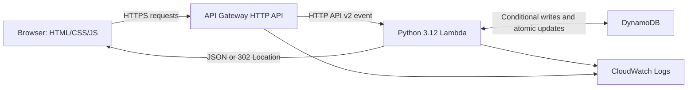

# Small Link — Serverless URL Shortener

A hands-on AWS learning project: turn a long URL into an eight-character code, redirect visitors, and track redirect requests. Built with Python 3.12 and plain HTML, CSS, and JavaScript.

**Status: deployed and verified in AWS us-east-2 on October 19, 2026.**

Live app: **https://yuhirl.netlify.app/**

AWS backend: **https://oe8duuof0f.execute-api.us-east-2.amazonaws.com**

The Free plan remains active. See [deployment details](docs/DEPLOYMENT.md) for resources, verification, the startup fix, and monitoring instructions.

The free Netlify address provides shorter share links while retaining the AWS backend. Published October 20, 2026 on Netlify's Free plan. See [Netlify setup](docs/NETLIFY.md) for the upload package, verification, and proxy behavior.

## Run locally

The environment is already installed in `.venv` on this computer:

```bash
cd ~/Developer/AWS/serverless-url-shortener
.venv/bin/python local_server.py
```

Open **http://127.0.0.1:8000**. Keep that terminal running; press **Ctrl+C** to stop it. If port 8000 is occupied, use `--port 8001` and open the printed URL.

The local server binds only to your computer. It uses `.local/links.sqlite3`, never loads AWS credentials, and does not call AWS. Restarting preserves your links. A local link works only on your computer while the server is running. Do not use Python's development server as a public production server.

For a fresh checkout with Python 3.12 installed:

```bash
python3.12 -m venv .venv
.venv/bin/python -m pip install -r requirements-dev.lock
.venv/bin/python local_server.py
```

Alternatively, with `uv`: `uv venv --python 3.12` then `uv pip install --python .venv/bin/python -r requirements-dev.lock`. The local application itself uses only Python's standard library; the SDK and test tools are for the AWS adapter and verification.

## Try it yourself

1. Enter a long public HTTPS URL and select **Shorten link**.
2. Copy or open the returned link. It should redirect to your destination.
3. Return to the app and select **Refresh counts**. The count increases by one for each GET redirect request.
4. Refresh counts again; reading statistics does not add a visit.
5. Try `http://127.0.0.1/private`; the backend rejects local/private destinations.
6. Restart the server and refresh the page. Your saved links remain available.

The browser remembers up to 20 recent codes in localStorage. The server stores the actual destinations and counts. A different browser does not automatically have your recent-links list.

Command-line walkthrough (no AWS calls):

```bash
curl -sS -X POST http://127.0.0.1:8000/api/links \
  -H 'Content-Type: application/json' \
  -d '{"url":"https://docs.aws.amazon.com/lambda/latest/dg/welcome.html"}'

# Replace CODE with the returned eight-character code.
curl -i http://127.0.0.1:8000/r/CODE
curl -sS http://127.0.0.1:8000/api/links/CODE
```

The redirect request returns `302` and a `Location` header. `curl` does not follow it unless you add `-L`. Use GET as shown; `curl -I` sends HEAD and intentionally does not count as a visit.

## Architecture



Lambda also serves the small frontend from its deployment package. This keeps everything on one origin and avoids adding a separate hosting service for the first version. Static files do incur API/Lambda requests in AWS. At larger scale, S3 plus CloudFront would be a useful separate hosting phase.

Locally, `local_server.py` translates HTTP requests into the same event shape and substitutes SQLite for DynamoDB. This verifies application behavior, but is not a full emulator of API Gateway, IAM, Lambda cold starts, or DynamoDB's managed service.

| Component | What it teaches |
| --- | --- |
| API Gateway HTTP API | Routes, HTTP requests/responses, throttling |
| Lambda on-demand | Event handlers, stateless compute, runtime configuration |
| DynamoDB on-demand | Partition keys, conditional writes, atomic counters, TTL |
| CloudWatch | Minimal application/access logs and built-in metrics |
| SAM / CloudFormation | Infrastructure as code and resource relationships |
| IAM execution role | Least-privilege service-to-service permissions |
| Git | Reviewable local source history; GitHub publication is a later action |

See [the learning walkthrough](docs/LEARNING.md) for a detailed explanation and [costs and deployment boundaries](docs/COSTS.md).

## Project layout

```text
backend/
  app.py                 Shared application logic and Lambda entry point
  storage.py             SQLite and DynamoDB adapters
  requirements.txt       Lambda's SDK dependency
  static/                HTML, CSS, JavaScript frontend
docs/
  LEARNING.md            Architecture, data model, decisions, exercises
  COSTS.md               Free plan support, usage estimates, deployment checklist
  SECURITY.md            Protections, known limitations, privacy
tests/                   Unit, concurrency, mocked DynamoDB, real local HTTP tests
local_server.py          Local-only development server
template.yaml            Future AWS SAM infrastructure
requirements-dev.txt     Development dependency inputs
requirements-dev.lock    Exact installed development versions
.python-version          Python 3.12
.gitignore               Excludes environments, credentials, runtime data, caches
```

## API

| Method | Route | Behavior |
| --- | --- | --- |
| GET | `/` | Frontend |
| GET | `/app.js`, `/styles.css` | Frontend assets |
| POST | `/api/links` | JSON `{"url":"https://..."}` → 201 with code, short URL, destination, visits, timestamps |
| GET | `/r/{code}` | Atomically increment visits and return 302 |
| HEAD | `/r/{code}` | Return redirect headers without incrementing |
| GET | `/api/links/{code}` | Read statistics without incrementing |

Timestamps are Unix seconds. Validation errors return 400, unknown/expired links 404, oversized bodies 413, unsupported content types 415, creation limits 429 with `Retry-After`, and storage failures 503. Links expire after 30 days. There are no user accounts or private statistics.

## Automated verification

```bash
.venv/bin/python -m pytest -q
.venv/bin/python .venv/bin/cfn-lint template.yaml
```

Tests cover the request lifecycle, input validation, random-code collisions, expiration, concurrent counter updates, shared creation limits, SQLite persistence, error sanitization, real HTTP requests, and the DynamoDB adapter using **Moto**. Moto intercepts AWS calls and uses dummy test credentials; it does not access your project. The HTTP test briefly binds an ephemeral localhost port.

`cfn-lint` validates/transforms the SAM template locally. SAM CLI 1.168.0 and CloudFormation Guard 3.2.1 are installed. The local build, scoped Guard checks, 59 automated tests, and deployed HTTP smoke test passed. See [verification details](docs/VERIFICATION.md).

## Safety and future updates

The deployed target is profile `student-aws`, selected Region `us-east-2`, on the active Free plan. Verify the assigned Region in **AWS Settings → View all projects → Overview → Additional Info → Region** before future deployments.

Nothing in the run/test commands deploys infrastructure. There is deliberately no automatic deployment workflow. Explicit approval is required before deploying, creating IAM roles/policies, upgrading the plan, or deleting AWS resources.

The template describes one Lambda, one HTTP API, one DynamoDB table, two log groups with seven-day retention, and a least-privilege Lambda execution role. DynamoDB is retained on stack removal/replacement to avoid accidental data loss; retained storage can continue consuming credits. Any later cleanup requires approval.

Basic protections and limitations are documented in [SECURITY.md](docs/SECURITY.md). Do not shorten secret-bearing URLs. This is a portfolio learning demo, not a public abuse-resistant shortening service.
